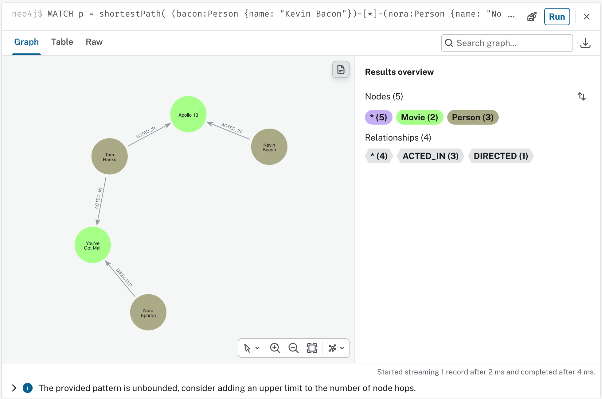
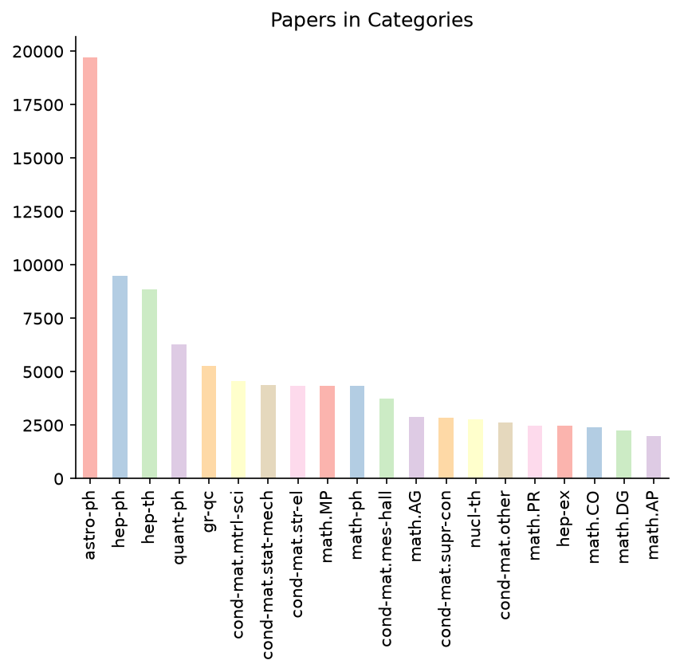

# Neo4j Academic Papers: Graph Database Lab (BYU CS 452)

An introduction to **graph databases** with [Neo4j](https://neo4j.com/). It has two parts:

1. **Movies graph:** find the "Bacon path" (shortest chain of movies and collaborators) from Kevin Bacon to **Nora Ephron**.
2. **ArXiv papers graph:** load 100,000 arXiv paper records into Neo4j as `Paper`, `Author`, and `Category` nodes,
   then answer questions about them with Cypher. The headline question: *how many papers are in computer-science categories?*

This was built for BYU CS 452 (Database Modeling Concepts), based on CJ Sullivan's tutorial
*"Create a graph database in Neo4j using Python"* (Towards Data Science) and the
[class starter notebook](https://github.com/byu-cs-452/byu-cs-452-class-content/blob/main/notebooks/neo4j_lab.ipynb).



## Results

| Question | Answer |
|---|---|
| Bacon path to Nora Ephron | Kevin Bacon → *Apollo 13* ← Tom Hanks → *You've Got Mail* ← Nora Ephron (4 hops) |
| Total papers in the dataset | **100,000** |
| **Unique papers in at least one CS category** (official answer) | **5,812** |
| Paper–category memberships in CS (cross-listed papers counted once per category) | 7,891 |

The two CS numbers differ because 1,792 papers are cross-listed in 2 or more CS categories (for example `cs.AI` + `cs.LG`).
`count(DISTINCT p)` counts each paper once, while `count(p)` counts every paper→category relationship:

```cypher
MATCH (p:Paper)-[:IN_CATEGORY]->(c:Category)
WHERE c.category STARTS WITH 'cs.'
RETURN count(DISTINCT p) AS uniqueCsPapers      // 5,812
```



## The graph model

```
(:Author {name})-[:AUTHORED]->(:Paper {id, title})-[:IN_CATEGORY]->(:Category {category})
(:Person {name})-[:ACTED_IN|DIRECTED|PRODUCED|WROTE|...]->(:Movie {title, released})
```

## What's in this repo

| File | What it is |
|---|---|
| [`neo4j_lab.ipynb`](neo4j_lab.ipynb) | The main notebook, executed with all outputs: data load, category queries, CS totals, and "something fun" queries |
| [`neo4j_academic_papers_passoff.pdf`](neo4j_academic_papers_passoff.pdf) | Pass-off report: Bacon path, bar chart, CS totals, queries, explanation, extra query |
| [`LEARNING_NOTES.md`](LEARNING_NOTES.md) | Study notes on Cypher concepts, graph vs. relational, secrets handling, and a quiz |
| [`NOTES.md`](NOTES.md) | Assumptions and decisions made while building the project |
| `bacon_path_nora_ephron.png` | Neo4j Browser screenshot of the Bacon path |
| `indegree_by_category.png`, `indegree_cs_categories.png` | Bar charts of papers per category |
| `scripts/` | Helper scripts: DB connection, Movies load + Bacon path, Browser screenshot, notebook editing, PDF builder |
| `output/` | Query results saved as JSON (used to build the PDF) |

## Run it yourself

**Prerequisites:** Docker, Python 3.10+.

```bash
# 1. Python environment
python3 -m venv .venv
.venv/bin/pip install -r requirements.txt
.venv/bin/python -m playwright install chromium          # only needed for the screenshot script
.venv/bin/python -m ipykernel install --user --name neo4j-cs452

# 2. Credentials (never committed; .env is in .gitignore)
PW=$(openssl rand -hex 16)
printf "NEO4J_URI=bolt://localhost:7687\nNEO4J_USER=neo4j\nNEO4J_PASSWORD=%s\n" "$PW" > .env

# 3. Neo4j 5 with the APOC plugin
docker run -d --name neo4j-cs452 -p 7474:7474 -p 7687:7687 \
  -e NEO4J_AUTH=neo4j/$PW -e NEO4J_PLUGINS='["apoc"]' neo4j:5

# 4. Part 1: Movies graph + Bacon path (+ Browser screenshot)
curl -sL -o movies.cypher https://raw.githubusercontent.com/neo4j-graph-examples/movies/main/scripts/movies.cypher
.venv/bin/python scripts/part1_movies.py
.venv/bin/python scripts/screenshot_bacon.py

# 5. Part 2: run the notebook top to bottom (downloads the 131 MB dataset on first run)
.venv/bin/jupyter nbconvert --to notebook --execute --inplace neo4j_lab.ipynb \
  --ExecutePreprocessor.timeout=-1 --ExecutePreprocessor.kernel_name=neo4j-cs452

# 6. Build the PDF report
.venv/bin/python scripts/build_pdf.py

# When done
docker stop neo4j-cs452
```

Open the Neo4j Browser at <http://localhost:7474> to explore the graph visually. Port **7474** serves the web UI over
HTTP, and port **7687** is the **Bolt** binary protocol that the Python driver and the Browser use to run queries.

> The dataset (`metadata.csv`, ~131 MB) is not committed because it is over GitHub's 100 MB file limit.
> The notebook downloads it automatically.

## Tech

Neo4j 5 · APOC · Cypher · Python (`neo4j` driver, pandas, matplotlib) · Jupyter · Docker · Playwright · ReportLab

*Built with the help of an AI coding agent (Claude Code), as the course allows.*
